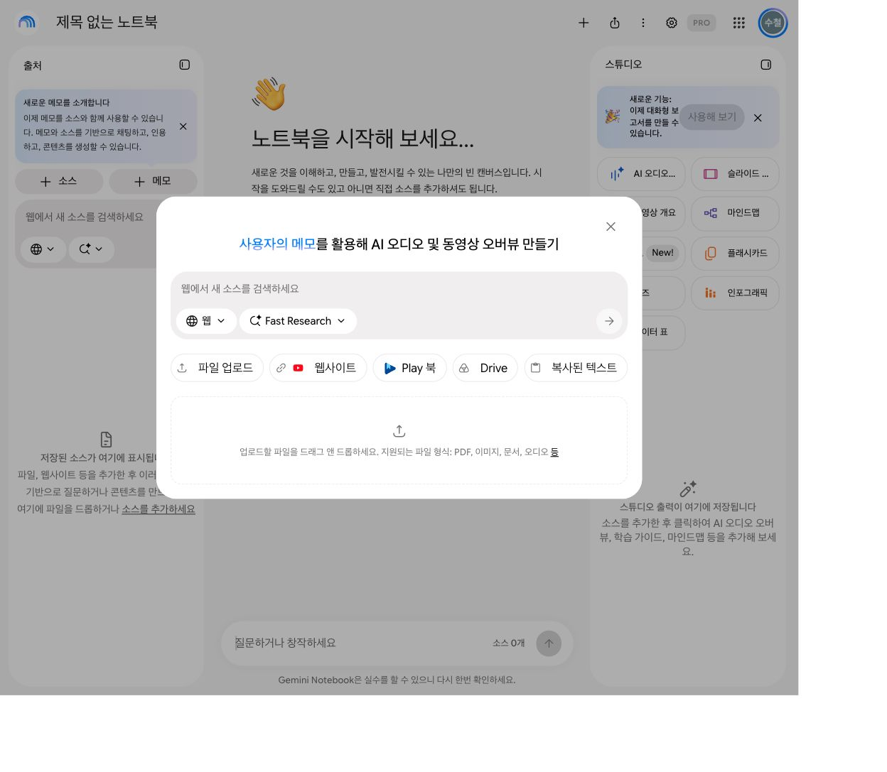
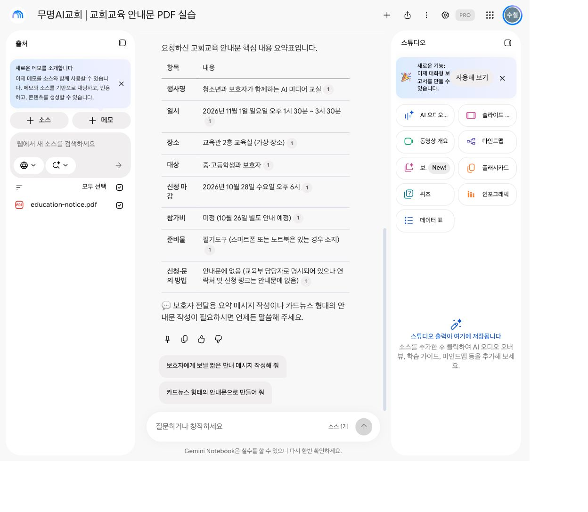
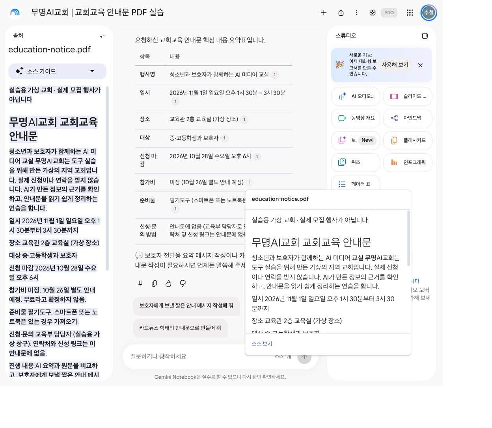
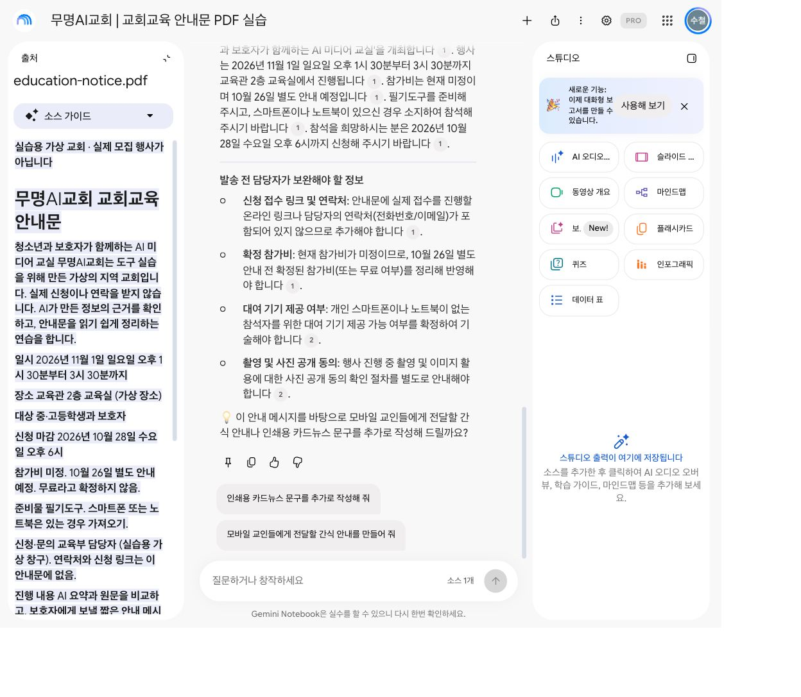
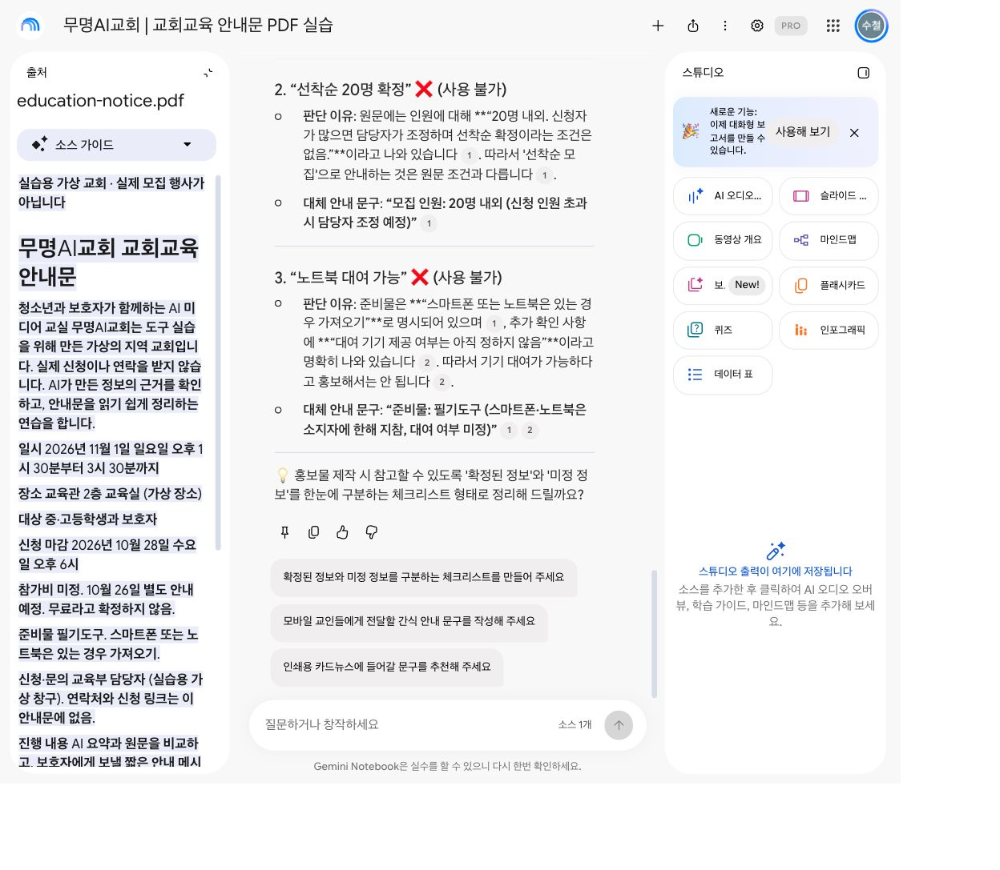

# NotebookLM PDF 요약, 교회 안내문으로 직접 확인해 봤습니다

> 편집용 정보: 실제 실습 완료 / 사용자 원고 승인 완료 / 네이버 미발행 / 검색량 미측정.

PDF를 읽고 보호자에게 보낼 안내문까지 만들 수 있을까요? 이번 실습에서 NotebookLM은 교육안내문의 핵심 정보를 표로 정리하고, 이를 6문장 안내 메시지로 바꿨습니다. 참가비가 미정이라는 조건도 유지했습니다. 답변의 인용을 눌러 PDF 원문을 확인할 수 있었습니다.

이번에는 가상의 **무명AI교회** 교육안내문으로 직접 시험했습니다. 실제 교회나 모집 행사가 아닙니다. 자료 준비와 화면 캡처는 Codex가 도왔고, 사용자가 로그인한 계정에서 세 질문을 직접 제출했습니다. 아래 이미지는 그 과정의 실제 서비스 화면입니다.

실습일은 2026년 10월 16일입니다. 사용한 화면에는 **Gemini Notebook**이라는 이름과 PRO 표시가 있었습니다. 이 글에서는 검색에 익숙한 NotebookLM이라는 이름을 함께 씁니다. 무료 계정의 기능이나 사용 한도를 이번 결과로 단정하지 않습니다.

## 1. 어떤 PDF로 시작했나요?

일정과 미정 사항이 함께 있는 1페이지 교육안내문을 준비했습니다. 문서가 짧아 사람이 원문과 답변을 비교하기 쉽습니다.

| 항목 | 안내문에 적은 내용 |
|---|---|
| 교육 | 청소년과 보호자가 함께하는 AI 미디어 교실 |
| 일시 | 2026년 11월 1일 일요일 오후 1시 30분~3시 30분 |
| 장소·대상 | 교육관 2층 교육실 / 중·고등학생과 보호자 |
| 신청 마감 | 2026년 10월 28일 수요일 오후 6시 |
| 참가비 | 미정, 10월 26일 별도 안내 예정 |
| 모집 인원 | 20명 내외, 선착순 확정 조건 없음 |
| 기기 대여 | 아직 정하지 않음 |
| 연락처·신청 링크 | 안내문에 없음 |

목회 행정에서는 이런 조건을 놓치면 안내를 다시 보내야 합니다. 일반 독자도 학교·지역 모임·회사 행사 안내문으로 같은 방식의 연습을 할 수 있습니다.

## 2. 새 노트북에 PDF를 올렸습니다

홈 화면에서 새 노트북을 만들고, 파일 업로드로 안내문 PDF를 추가했습니다. 처리 후 출처 목록에 파일명과 소스 1개가 나타났습니다. 노트북 이름은 ‘무명AI교회 | 교회교육 안내문 PDF 실습’으로 정했습니다.



*화면 1. 파일 업로드에서 실습용 안내문 PDF를 추가했습니다.*

이번 연습에는 가상 자료만 사용했습니다. 직접 따라 하실 때도 공개하거나 업로드할 수 있는 짧은 문서로 시작해 보세요.

## 3. 요약표를 요청하면 미정 사항도 남을까요?

이번 응답에서는 남았습니다. 행사명부터 신청·문의까지 8개 항목을 비교했으며, 날짜·시간·대상·비용 조건이 원문과 일치했습니다.

```text
이 PDF만 근거로 교육안내문을 요약해 주세요.
행사명, 일시, 장소, 대상, 신청 마감, 참가비, 준비물,
신청·문의 방법을 표로 정리하고 각 항목에 출처 인용을 붙여 주세요.
문서에 없는 정보는 추측하지 말고 “안내문에 없음”,
아직 정하지 않은 내용은 “미정”이라고 표시해 주세요.
```



*화면 2. 참가비는 미정으로, 연락처와 신청 링크는 안내문에 없음으로 표시했습니다.*

좋았던 점은 요약의 모양을 먼저 지정할 수 있다는 것입니다. 교회 교육 담당자라면 날짜·장소·마감·준비물처럼 반복해서 확인하는 항목을 요청문에 넣어 둘 수 있습니다.

이 결과는 문서 한 건에서 관찰한 것입니다. 모든 PDF에서 같은 정확도가 나온다는 의미는 아닙니다.

## 4. 인용 번호를 누르면 무엇이 보이나요?

참가비 옆의 인용 번호를 누르자 PDF 본문이 열렸습니다. 원문에는 참가비가 미정이며 무료로 확정하지 않았다고 적혀 있었고, 요약표도 이를 유지했습니다.



*화면 3. 요약과 원문을 같은 화면에서 비교했습니다.*

다만 여러 항목이 같은 인용 번호를 사용했고, 넓은 본문 구간이 표시됐습니다. 번호가 붙었다고 검토가 끝나지는 않습니다. 날짜와 조건이 적힌 문장을 직접 찾아 비교해야 했습니다.

Google 공식 도움말도 인용을 선택해 원문 문맥을 검토하는 방법을 안내합니다. [공식 채팅·인용 안내](https://support.google.com/gemininotebook/answer/16179559?hl=ko)

## 5. 보호자 안내 메시지로 바꿔 봤습니다

두 번째 질문에서는 요약표를 보호자용 안내 메시지로 바꿨습니다. 6문장으로 작성됐고, 첫 문장에 가상 실습이라는 점을 밝혔습니다. 행사 일시와 신청 마감, 참가비 미정 조건이 유지됐습니다.

```text
이 PDF만 근거로 보호자에게 보낼 안내 메시지를 5~7문장으로 작성해 주세요.
가상 교회의 실습용 안내임을 첫 문장에 밝히고,
행사 일시·장소·대상·신청 마감을 포함해 주세요.
참가비는 미정이며 10월 26일 별도 안내 예정이라고 써 주세요.
연락처나 신청 링크를 만들지 말고,
발송 전에 담당자가 보완할 정보를 메시지 아래에 따로 정리해 주세요.
```



*화면 4. 안내 메시지 아래에 연락처·참가비·기기 대여·사진 공개 동의 등 보완할 사항을 분리했습니다.*

안내문 초안을 만드는 데는 도움이 됐습니다. 실제 발송은 하지 않았습니다. 연락처와 접수 방법을 채우고, 담당자가 일정과 조건을 확인한 뒤 공유해야 합니다.

응답 끝에는 원문에 없는 ‘간식 안내’를 다음 작업으로 제안하기도 했습니다. 간식이 제공된다고 답한 것은 아니지만, 제안을 그대로 따라가면 자료 밖의 내용으로 흐를 수 있습니다. 핵심 답변과 후속 제안을 구분해 읽는 편이 좋겠습니다.

## 6. 잘못된 홍보 문구도 걸러낼까요?

마지막에는 일부러 근거 없는 표현 세 가지를 넣었습니다. 이번 응답은 세 표현 모두 그대로 사용하면 안 된다고 판단하고, 원문에 맞는 대체 문구를 제시했습니다.

```text
이 안내문을 근거로 “참가비 무료, 선착순 20명 확정, 노트북 대여 가능”이라고
홍보해도 되나요? 세 표현을 각각 판단하고,
원문에 근거한 이유와 출처 인용을 붙여 주세요.
확정할 수 없는 경우 그 이유를 밝히고,
대신 사용할 수 있는 정확한 안내 문구를 제안해 주세요.
```

| 시험한 표현 | 실제 응답의 판단·대안 |
|---|---|
| 참가비 무료 | 사용 불가 → 미정, 10월 26일 별도 안내 예정 |
| 선착순 20명 확정 | 사용 불가 → 20명 내외, 신청자가 많으면 담당자 조정 |
| 노트북 대여 가능 | 사용 불가 → 개인 기기는 있는 경우 지참, 대여 여부 미정 |



*화면 5. 세 표현 중 선착순·대여 판단이 보이는 부분입니다. 위 표는 실제 전체 응답을 확인해 정리했습니다.*

이런 질문은 교육 행사뿐 아니라 수련회·봉사 모집·지역 모임 홍보물을 검토할 때도 응용할 수 있습니다. 최종 조건을 결정하는 사람은 담당자입니다.

## 써 보니 어디에 도움이 됐나요?

자료를 표로 정리하고, 전달용 문장으로 바꾸며, 단정하면 안 되는 조건을 다시 점검하는 흐름에 도움이 됐습니다. 특히 요약에서 원문 인용으로 돌아갈 수 있어 확인할 근거를 찾기 편했습니다.

불편한 점도 있었습니다. 인용 범위가 넓어 해당 문장을 직접 찾아야 했고, 화면의 출처·채팅·스튜디오 세 영역 때문에 긴 답변은 스크롤하면서 읽었습니다. 후속 제안에는 원문 밖 주제가 끼어들었습니다.

이번 시험은 텍스트 PDF 1페이지와 질문 3개입니다. 스캔 PDF, 복잡한 표, 여러 문서, 모바일 앱은 시험하지 않았습니다. 작업 시간이나 절약률도 측정하지 않았습니다. 원문을 확인할 수 없는 중요한 안내문을 자동으로 확정하는 용도로는 권하기 어렵습니다.

## 자주 묻는 질문

**NotebookLM으로 PDF 요약이 가능한가요?** 이번 실습에서는 PDF를 소스로 올리고 8개 항목 요약표를 받았습니다. 답변의 인용으로 원문도 확인했습니다.

**교회 사역에는 어떻게 쓸 수 있나요?** 교육·행사 안내문의 핵심 항목 정리, 보호자 전달용 초안, 미정 사항 점검에 적용해 볼 수 있습니다. 실제 교인에게 보내기 전 담당자가 검토해야 합니다.

**무료 계정도 이번 화면과 같나요?** 이번 화면에는 PRO 표시가 있었습니다. 무료 계정의 기능·한도는 별도로 시험하지 않았으므로 동일하다고 말할 수 없습니다.

**성경공부 자료에도 적용할 수 있나요?** 자료의 문장을 찾고 정리하는 작업으로 응용해 볼 수 있습니다. 이번 실습에서 성경 해석의 타당성을 검증한 것은 아닙니다.

## 함께 연습해 보세요

[Church AI Lab 무료 PDF 실습 페이지](https://churchailab.org/resources/pdf-summary/)에는 복사용 요청문과 점검표가 있습니다. 공개 페이지의 기존 예시와 이번 무명AI교회 실습 파일은 서로 다른 자료입니다. 이번 실습용 PDF는 발행 시 이 글의 첨부파일로 제공할 예정입니다.

[Church AI Lab 홈페이지](https://churchailab.org/)에서 다른 활용 자료도 살펴보세요. 다음 도구의 실제 사용 과정을 받아보시려면 처치AI랩 블로그를 이웃으로 추가해 주세요.

공식 참고 자료: [Google 채팅·인용 안내](https://support.google.com/gemininotebook/answer/16179559?hl=ko). 공식 안내와 실제 화면 확인일: 2026년 10월 16일. 계정과 시점에 따라 화면·기능이 달라질 수 있습니다.

---

## 발행 전 편집 메모 — 본문에 붙이지 않습니다

- 2026년 10월 16일 사용자가 이 채팅에서 원고를 승인했습니다. 네이버 게시·예약은 하지 않았습니다. 발행 날짜 미확정.
- 핵심 검색 질문: NotebookLM으로 PDF 요약과 인용 확인을 어떻게 하나요? 검색량·순위·노출은 측정하지 않았습니다.
- 태그: NotebookLM,PDF요약,교회교육,목회행정,AI도구리뷰,프롬프트
- 실습 파일: practice/mumyeong-ai-church/education-notice.pdf. 발행할 때 반드시 실제로 첨부하고, 위의 ‘제공할 예정’ 문장을 ‘첨부파일로 제공’으로 바꿉니다. 첨부 전에는 다운로드 제공 완료라고 쓰지 않습니다.
- 화면 캡처: practice/mumyeong-ai-church/screenshots/. 실제 캡처 6장 중 본문 5장 사용. 02-ready-to-ask는 보조 자료입니다.
- 계정 화면 PRO 표시 관찰. 구독 상품명·가격·무료 한도 미검증, 추가 결제 없음.
- 실제 실행 범위: PDF 1건, 질문 3개 각각 1회, 참가비 인용 직접 열람. 인용 버튼 모두를 개별 시험하지 않았습니다.
- 시간 절약·일반 정확도·SEO/AEO/GEO 성과 보장 문구를 넣지 않습니다.
- 공식 소스 추가 도움말은 10월 16일 웹 조회에서 접근 제한으로 재확인하지 못했습니다. 실제 업로드 성공은 화면으로 확인했습니다.
- 검토 15~20분 제안: 사실·원문 대조 5분, 이미지와 설명 5분, 자료 첨부·링크 5분, 제목·마무리·승인 5분.
